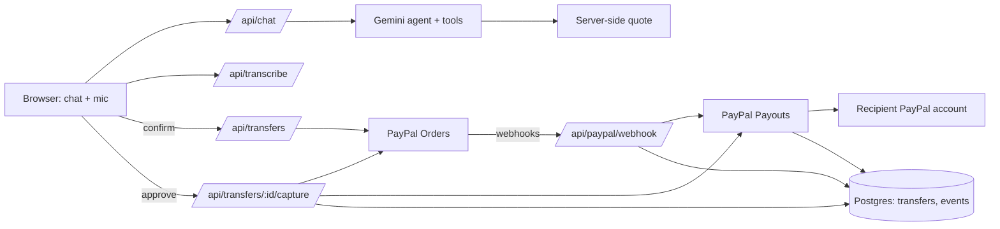

# Tuma: AI-powered diaspora-to-family payments (PayPal AI Hackathon)

Send money home by chat in Swahili, French, English or Pidgin. An AI agent prepares the transfer,
the sender confirms a quote, pays via PayPal checkout, and tracks delivery.

## Setup
1. `npx create-next-app@latest tuma --ts --app --src-dir --tailwind --eslint --import-alias "@/*"`
2. Copy this folder over the new project, then `npm i pg @paypal/react-paypal-js @google/genai && npm i -D @types/pg`
3. `cp .env.example .env.local` and fill in the PayPal sandbox credentials and `GEMINI_API_KEY` (free from Google AI Studio)
4. `psql $DATABASE_URL -f db/schema.sql -f db/002_recipients.sql -f db/003_paypal_payouts.sql -f db/004_receipts.sql`, then set the demo recipient's `paypal_email` to a sandbox personal account email
5. `npm run dev`

## What is real vs simulated
| Leg | Status |
|---|---|
| Sender pays via PayPal checkout | Real (sandbox) |
| Webhooks, capture | Real (sandbox) |
| Payout to recipient's PayPal account (Payouts API) | Real (sandbox) |
| Recipient withdrawing to a Kenyan bank | Not simulated (outside the app) |

License: MIT

## Architecture


## Deploy (Render + Neon)
1. Create a free Postgres database (Neon) and run `DATABASE_URL=... sh db/migrate.sh`.
2. Push the repo to GitHub and create a Render web service from `render.yaml`; set the env vars it lists.
3. In your PayPal sandbox app, register `https://<your-app>.onrender.com/api/paypal/webhook` for `PAYMENT.CAPTURE.COMPLETED` and the payout item events, and put the webhook ID in `PAYPAL_WEBHOOK_ID`.
4. Test with a sandbox buyer and a sandbox "mama" account (see `docs/SUBMISSION.md` for test phrases).

## Tests
Unit and route tests run with [Vitest](https://vitest.dev). External services (PayPal, Gemini, Postgres) are mocked, so no keys or database are needed.

```bash
npm i -D vitest
npm pkg set scripts.test="vitest run"
npm test
```

Keep tests out of the Next.js type-check by adding `"tests"` and `"vitest.config.ts"` to `exclude` in `tsconfig.json`.

| File | What it covers |
|---|---|
| `quote.test.ts` | Fee/total/FX math, $1 to $1,000 limits, unsupported countries |
| `transfers.test.ts` | State machine: every legal and illegal transition, audit events, rollback, column whitelist |
| `paypal.test.ts` | Orders, capture, payouts, refunds, idempotency keys, error mapping, webhook verification |
| `payout.test.ts` | Payout start, retry vs refund-on-permanent-failure, delivered/failed/unclaimed sync |
| `webhook.test.ts` | Signature check, de-duplication, capture and payout events |
| `routes.test.ts` | Create transfer (server-side quote), capture, chat input limits |
| `agent.test.ts` | Tool calling, nicknames (maman/mum), quote safety, loop cap |
| `gemini.test.ts` | Free-tier model fallback on 429/500/503 |
| `receipt.test.ts` | Localized receipts, caching, refund wording, fallback text |

CI runs `npm test` on every push (`.github/workflows/test.yml`).
